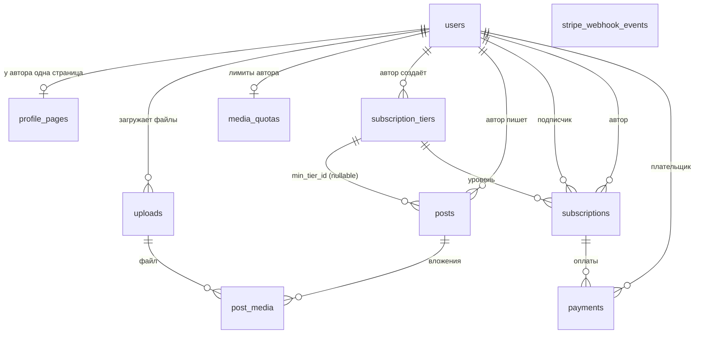

# Страница автора, платные подписки и Stripe Connect: дизайн БД

> Черновик дизайна. Учитывает текущую схему (`users.referred_by_id`, `posts`) и модель «реферер = автор, рефералы = читатели».
>
> **Решения, принятые на сейчас:**
> - Деньги за подписку получают **авторы** (рефереры), платформа берёт комиссию → **Stripe Connect**.
> - У каждого автора есть **своя публичная страница** в стиле guns.lol (фон, эффекты, ссылки), которая служит и визиткой, и точкой входа для рефералов.

---

## 0. ⚠️ Проверить до начала работы со Stripe

Stripe Connect доступен не во всех странах — ни для платформы, ни для получателей выплат. **Stripe не работает с Россией и Беларусью.** Если авторы (или ты как владелец платформы) находятся там, Connect-аккаунт создать не получится.

Перед реализацией платёжной части проверь:
- страну, в которой будет зарегистрирован **твой** Stripe-аккаунт платформы;
- страны, где живут **авторы** (список стран для Connect-получателей есть в документации Stripe);
- актуальные тарифы Connect (у Express-аккаунтов есть плата за активный аккаунт и за выплаты).

Если Stripe не подходит — схема ниже почти не меняется: поля `stripe_*` переименовываются в общие (`provider`, `provider_customer_id`, `provider_subscription_id` и т.д.), логика статусов и вебхуков у большинства провайдеров похожа.

**Текущий статус:** платформа будет в **Литве** (ЕС) — Stripe и Connect там поддерживаются полностью. Открытые вопросы:
- **Авторы из Украины** — проверить, поддерживает ли Connect выплаты туда (вероятно, нет). Если нет — на старте выплаты только авторам из поддерживаемых стран.
- **Юридическое** (с литовским бухгалтером): форма бизнеса (IV / MB / UAB), НДС платформы (возможно, со всей суммы подписки, по стране покупателя через OSS), применимость DAC7, требования DSA (жалобы, правила контента), 14-дневное право отказа для цифровых услуг.

---

## 1. Общая картина

| Таблица | Зачем |
|---|---|
| `users` | + поля Stripe-клиента (для подписчика) и Connect-аккаунта (для автора) |
| `profile_pages` | Публичная кастомизируемая страница автора |
| `uploads` | Все загруженные файлы: фото, видео, аватары, фоны, музыка. Со статусом обработки |
| `media_quotas` | Лимиты автора на хранилище и минуты видео |
| `subscription_tiers` | Уровни подписки, которые создаёт автор. Связаны со Stripe Price |
| `posts` | + `min_tier_id` — с какого уровня пост доступен |
| `post_media` | Какие файлы прикреплены к посту и в каком порядке |
| `subscriptions` | **Все** подписки: и текущая, и прошлые. Текущая = строка с «живым» статусом |
| `payments` | История оплат (по инвойсам Stripe) |
| `stripe_webhook_events` | Журнал вебхуков — защита от двойной обработки |

---

## 1.1 Выбор технологий для медиа

| Задача | Рекомендация | Почему | Альтернативы |
|---|---|---|---|
| **Объектное хранилище** (фото, аватары, фоны, музыка) | **Cloudflare R2** | S3-совместимое API (в Go — обычный AWS SDK), **нет платы за исходящий трафик** (главная статья расходов медиаплатформы), можно создать бакет с юрисдикцией **EU** — данные физически в ЕС (удобно для GDPR) | Backblaze B2, Hetzner Object Storage, AWS S3 (дорогой трафик) |
| **Видео** (перекодирование, стриминг, защита) | **Cloudflare Stream** | Тот же аккаунт и счёт, что R2. Сам перекодирует, отдаёт HLS, есть плеер, **подписанные токены** для платных видео, прямая загрузка с клиента | **Bunny Stream** — обычно дешевле, компания из ЕС (Словения). **Mux** — самый удобный API, но дороже |
| **Обработка картинок** | **libvips** через Go-биндинги (`govips`) в фоновой задаче | Очень быстрый и экономный по памяти; удаляет метаданные (EXIF/GPS), конвертирует в WebP/AVIF, делает превью | **imgproxy** — отдельный сервис, ресайзит «на лету» из бакета по подписанной ссылке (тогда варианты заранее не генерируются). Cloudflare Images — платно |
| **Фоновые задачи** (обработка после загрузки, очистка мусора) | **River** (`riverqueue`) | Очередь задач для Go **поверх Postgres** и pgx — то, что у тебя уже есть. Не нужен Redis/RabbitMQ; задачу можно поставить в той же транзакции, что и запись в БД | Asynq (нужен Redis) |
| **Проверка на CSAM** | **Cloudflare CSAM Scanning Tool** | Бесплатный, включается для домена, сверяет изображения с базами хэшей | — (для прода в ЕС проверка обязательна по смыслу DSA) |
| **Локальная разработка** | Отдельный **dev-бакет в R2** и тестовое видео в Stream | Проще всего — то же API, что в проде | Локальное S3-совместимое хранилище в docker-compose (SeaweedFS, Garage; у MinIO в 2025 менялись условия распространения community-версии — проверь актуальный статус) |

**Итог:** всё медиа — в экосистеме Cloudflare (R2 + Stream + CSAM-сканер + CDN/DNS перед сайтом). Один аккаунт, один счёт, меньше интеграций. Если видео выйдет дорогим — Stream меняется на Bunny Stream без изменений схемы (поля `provider`/`provider_asset_id` для этого и нужны).

**Хранилище и доступ:**
- Два бакета: **public** (аватары, фоны, музыка страниц — отдаются через CDN по обычной ссылке) и **private** (**все** медиа постов — только через подписанные ссылки с коротким сроком жизни; тогда смена поста с бесплатного на платный не требует переноса файлов).
- Твой Go-сервер **не пропускает файлы через себя**: клиент грузит напрямую в R2/Stream по одноразовой ссылке, которую выдаёт бэкенд.

---

## 2. Таблицы

### 2.1 `users` — новые колонки

**Как подписчик (плательщик):**

| Колонка | Тип | Null | Описание |
|---|---|---|---|
| `stripe_customer_id` | `TEXT` | да | `cus_...`. Создаётся при первой попытке оплатить. **UNIQUE** |

**Как автор (получатель денег):**

| Колонка | Тип | Null | Описание |
|---|---|---|---|
| `stripe_account_id` | `TEXT` | да | `acct_...` — Connect-аккаунт автора (тип **Express**), куда идут деньги. **UNIQUE** |
| `stripe_details_submitted` | `BOOLEAN` | нет, default `false` | Автор заполнил онбординг |
| `stripe_charges_enabled` | `BOOLEAN` | нет, default `false` | На этот аккаунт можно принимать платежи |
| `stripe_payouts_enabled` | `BOOLEAN` | нет, default `false` | Stripe может выплачивать деньги на банк автора |

Три флага обновляются из вебхука `account.updated`. **Пока `stripe_charges_enabled = false`, автор не может публиковать платные уровни** (создавать их как черновик — можно).

> Сам уровень подписки в `users` **не хранится** — он в `subscriptions`.
>
> Если колонок в `users` станет слишком много — Connect-поля можно вынести в отдельную таблицу `author_payout_accounts (user_id PK, ...)` со связью 1:1. На старте не обязательно.

---

### 2.2 `profile_pages` — публичная страница автора

| Колонка | Тип | Null | Описание |
|---|---|---|---|
| `user_id` | `UUID` PK, FK → `users.id` | нет | Связь 1:1 с юзером |
| `slug` | `VARCHAR(32)` | нет | Адрес страницы: `site.com/<slug>`. **UNIQUE** (без учёта регистра) |
| `display_name` | `VARCHAR(64)` | да | Имя на странице (может отличаться от `username`) |
| `bio` | `VARCHAR(500)` | да | Описание. Только текст, без HTML |
| `avatar_upload_id` | `UUID` FK → `uploads.id` | да | |
| `settings` | `JSONB` | нет, default `'{}'` | Всё оформление (см. ниже) |
| `settings_version` | `SMALLINT` | нет, default `1` | Версия структуры `settings` — для миграций формата в будущем |
| `is_published` | `BOOLEAN` | нет, default `false` | Пока `false` — страницу видит только автор |
| `views_count` | `BIGINT` | нет, default `0` | Простой счётчик просмотров |
| `created_at` | `TIMESTAMPTZ` | нет | |
| `updated_at` | `TIMESTAMPTZ` | да | |

**Что лежит в `settings` (пример структуры, не финальный):**

| Ключ | Что | Допустимые значения |
|---|---|---|
| `background.type` | Тип фона | `color` / `gradient` / `image` / `video` |
| `background.color` / `gradient` | Цвет(а) | только валидный hex |
| `background.upload_id` | Картинка/видео фона | ID из `uploads`, принадлежащий этому автору |
| `background.blur`, `background.dim` | Размытие, затемнение | числа в заданном диапазоне |
| `effects` | Эффекты | список из **фиксированного** набора: `snow`, `particles`, `rain`, `typewriter`, `glow`, `tilt`… |
| `theme.accent_color`, `theme.font` | Акцентный цвет, шрифт | hex; шрифт — из фиксированного списка |
| `music.upload_id`, `music.autoplay` | Фоновая музыка | ID из `uploads` |
| `links` | Ссылки на соцсети | массив `{type, url}`, `type` из списка (`telegram`, `discord`, `youtube`…), `url` — только `https://` |
| `blocks` | Что показывать на странице | `posts_preview`, `tiers`, `referral_button` — вкл/выкл и порядок |

**Почему JSONB, а не колонки:** эффекты и настройки будут постоянно добавляться. С JSONB для нового эффекта не нужна миграция — только обновить валидацию в Go и фронтенд.

**Правила безопасности (важно):**
- **Никакого пользовательского CSS / HTML / JS.** Только выбор из готовых опций. Иначе — XSS на твоём домене: чужая страница сможет украсть токены посетителей.
- Бэкенд **валидирует весь `settings` целиком** при сохранении: неизвестные ключи выкидываются, значения проверяются по типу и диапазону.
- Все `upload_id` в настройках должны принадлежать **этому же автору**.
- Ограничь размер `settings` (например, 16 КБ) и количество ссылок.

**Правила для `slug`:**
- Только `a-z`, `0-9`, `_`, `-`; длина 3–32.
- Уникальность без учёта регистра (хранить в нижнем регистре или уникальный индекс по `lower(slug)`).
- **Список зарезервированных слов**, которые пересекаются с твоими роутами: `api`, `login`, `register`, `admin`, `settings`, `social`, `posts`, `u`, `static`, `assets`…
- Решить, можно ли менять slug. Если да — старые ссылки сломаются (можно хранить историю для редиректов, но это позже).

**Связь со страницей и рефералкой:** на странице показывается кнопка «Присоединиться», которая ведёт на регистрацию с `own_referral_key` автора. Так страница становится основной точкой входа для новых рефералов.

**Индексы:** `UNIQUE (lower(slug))`.

---

### 2.3 `uploads` — загруженные файлы

Одна таблица для всех файлов: фото и видео в постах, аватары, фоны и музыка страницы. Файл проходит путь `pending → processing → ready` (или `failed`), поэтому у записи есть статус.

| Колонка | Тип | Null | Описание |
|---|---|---|---|
| `id` | `UUID` PK | нет | |
| `owner_id` | `UUID` FK → `users.id` | нет | Кто загрузил |
| `purpose` | `TEXT` | нет | Для чего: `avatar` / `page_background` / `page_music` / `post_media` |
| `media_type` | `TEXT` | нет | Что это: `image` / `video` / `audio` |
| `status` | `TEXT` | нет | `pending` (ссылка выдана, файл ещё не загружен) → `processing` → `ready` / `failed` / `rejected` (не прошёл модерацию/CSAM) |
| `provider` | `TEXT` | нет | Где лежит: `r2` (картинки, аудио) / `cf_stream` (видео). Позволяет сменить провайдера видео без миграции |
| `bucket` | `TEXT` | да | Для `r2`: `public` или `private` |
| `storage_key` | `TEXT` | да | Для `r2`: путь к **обработанному** файлу. **UNIQUE** |
| `provider_asset_id` | `TEXT` | да | Для видео: ID в Stream (Bunny/Mux). **UNIQUE** |
| `variants` | `JSONB` | да | Для картинок: ключи готовых размеров `{"thumb": "...", "medium": "...", "full": "..."}` |
| `original_filename` | `VARCHAR(255)` | да | Только для отображения автору. **Никогда** не использовать в путях |
| `mime_type` | `TEXT` | да | Определяется **по содержимому файла**, а не по расширению и не по тому, что прислал клиент |
| `size_bytes` | `BIGINT` | да | Реальный размер после загрузки (для квот) |
| `width`, `height` | `INTEGER` | да | Для картинок/видео |
| `duration_ms` | `INTEGER` | да | Для аудио/видео |
| `blurhash` | `VARCHAR(64)` | да | Крошечный «размытый» плейсхолдер — красиво показывать в ленте до загрузки и **в заблокированных платных постах** вместо самой картинки |
| `error` | `TEXT` | да | Причина `failed`/`rejected` |
| `created_at` | `TIMESTAMPTZ` | нет | |
| `ready_at` | `TIMESTAMPTZ` | да | |

**Правила:**
- Лимиты по размеру на каждый `purpose` + `media_type` (например: аватар 5 МБ, фото в посте 20 МБ, видео в посте 2–5 ГБ, музыка 15 МБ).
- Белый список форматов: фото — JPEG, PNG, WebP, HEIC (с айфонов), GIF; видео — то, что принимает Stream (MP4, MOV, WebM…); аудио — MP3, AAC, OGG.
- **Оригинал фото после обработки удаляется** (или кладётся в закрытый бакет без публичного доступа) — в нём EXIF с GPS.
- **Публичный или закрытый бакет определяется постом:** файл платного поста лежит в `private`. Если автор меняет пост с бесплатного на платный — файл нужно перенести (или изначально класть **все** медиа постов в `private` и отдавать через подписанные ссылки — проще и безопаснее, рекомендую так).
- `pending`-записи старше N часов и файлы, не привязанные ни к чему за сутки, — удаляет фоновая задача.

**Индексы:** `(owner_id, purpose)`, `(status, created_at)` — для фоновой очистки, `UNIQUE (provider_asset_id)`.

---

### 2.3.1 `media_quotas` — лимиты автора

Без квот один автор может залить терабайт, а счёт придёт тебе.

| Колонка | Тип | Null | Описание |
|---|---|---|---|
| `user_id` | `UUID` PK, FK → `users.id` | нет | |
| `storage_limit_bytes` | `BIGINT` | нет | Лимит хранилища (картинки + аудио) |
| `storage_used_bytes` | `BIGINT` | нет, default `0` | Обновляется при `ready` и при удалении файла |
| `video_minutes_limit` | `INTEGER` | нет | Видео в Stream тарифицируется **по минутам хранения и просмотра**, а не по байтам |
| `video_minutes_used` | `INTEGER` | нет, default `0` | |
| `updated_at` | `TIMESTAMPTZ` | нет | |

- Проверка квоты — **до** выдачи ссылки на загрузку (по заявленному размеру) и **после** обработки (по реальному).
- Счётчики обновлять в той же транзакции, что и статус `uploads`, чтобы не разъезжались.
- Позже лимиты можно привязать к тарифу автора (например, автор с платными подписчиками получает больше места).

---

### 2.4 `subscription_tiers` — уровни подписки автора

| Колонка | Тип | Null | Описание |
|---|---|---|---|
| `id` | `UUID` PK | нет | |
| `author_id` | `UUID` FK → `users.id` | нет | Чей это уровень |
| `level` | `SMALLINT` | нет | Порядок: 1, 2, 3… Чем больше — тем «выше». Сравнение доступа идёт по нему |
| `name` | `VARCHAR(100)` | нет | «Базовый», «Премиум» |
| `description` | `TEXT` | да | Что даёт уровень |
| `price_amount` | `INTEGER` | нет | Цена **в минимальных единицах** (центы): 500 = 5.00. Никогда не float |
| `currency` | `CHAR(3)` | нет | `usd`, `eur`… (Stripe использует нижний регистр) |
| `interval` | `TEXT` | нет | `month` / `year` |
| `stripe_product_id` | `TEXT` | да | `prod_...` |
| `stripe_price_id` | `TEXT` | да | `price_...` — **по нему** из вебхука понимаешь, какой это уровень. UNIQUE |
| `is_published` | `BOOLEAN` | нет, default `false` | Можно купить. Включается только если у автора `stripe_charges_enabled` |
| `is_archived` | `BOOLEAN` | нет, default `false` | Больше нельзя купить, но старые подписчики на нём остаются |
| `created_at` | `TIMESTAMPTZ` | нет | |
| `updated_at` | `TIMESTAMPTZ` | да | |

**Ограничения и индексы:**
- `UNIQUE (author_id, level)` — у автора не может быть двух уровней с одинаковым номером.
- `UNIQUE (stripe_price_id)`.
- `CHECK (level >= 1)`, `CHECK (price_amount > 0)`.

**Где живут Product и Price:** создавай их на **аккаунте платформы** (не на аккаунте автора). Это нужно для схемы destination charges (см. 3.2) — подписка живёт у тебя, а деньги переводятся автору.

**Важно про Stripe Price:** цена в Stripe **неизменяема**. Если автор меняет цену — создаётся **новый** Price, старый архивируется. Существующие подписчики остаются на старой цене. Для старта проще всего **запретить менять цену уровня** — только архивировать и создавать новый. Позже можно завести таблицу `tier_prices (tier_id, stripe_price_id, amount, is_active)`.

**Удаление уровня:** не удаляй физически — ставь `is_archived = true`. На уровень ссылаются посты и подписки.

---

### 2.5 `posts` — новая колонка

| Колонка | Тип | Null | Описание |
|---|---|---|---|
| `min_tier_id` | `UUID` FK → `subscription_tiers.id` | да | `NULL` = бесплатный пост. Иначе — доступен с этого уровня и выше |

- FK с `ON DELETE RESTRICT` (уровни и так не удаляются, а архивируются).
- Проверка на уровне приложения: `min_tier_id` должен принадлежать **тому же автору**, что и пост.
- Медиа в постах — через `post_media` (ниже).
- Пост, у которого есть медиа в статусе `processing`, можно либо не давать публиковать, либо публиковать с плейсхолдером «видео обрабатывается».

### 2.5.1 `post_media` — вложения поста

| Колонка | Тип | Null | Описание |
|---|---|---|---|
| `post_id` | `UUID` FK → `posts.id` | нет | `ON DELETE CASCADE` — удалил пост, удалились связи |
| `upload_id` | `UUID` FK → `uploads.id` | нет | `ON DELETE RESTRICT` — файл удаляется только через фоновую очистку |
| `position` | `SMALLINT` | нет | Порядок в посте (галерея) |
| `caption` | `VARCHAR(500)` | да | Подпись |

- PK `(post_id, upload_id)`, `UNIQUE (post_id, position)`.
- Ограничение на количество вложений в пост (например, до 20).
- Прикреплять можно только `uploads` того же автора с `purpose = post_media`.
- После удаления поста осиротевшие файлы удаляет фоновая задача (из хранилища и из Stream).

---

### 2.6 `subscriptions` — все подписки (текущая + история)

| Колонка | Тип | Null | Описание |
|---|---|---|---|
| `id` | `UUID` PK | нет | |
| `subscriber_id` | `UUID` FK → `users.id` | нет | Кто платит |
| `author_id` | `UUID` FK → `users.id` | нет | На кого подписка. Сейчас всегда = `referred_by_id` подписчика, но храним **снимком** — если реферер когда-то сменится, история не сломается |
| `tier_id` | `UUID` FK → `subscription_tiers.id` | нет | Текущий уровень (при апгрейде меняется) |
| `status` | `TEXT` | нет | Статус **как в Stripe** (см. ниже) |
| `stripe_subscription_id` | `TEXT` | нет | `sub_...`. **UNIQUE** — главный ключ для сопоставления с вебхуками |
| `application_fee_percent` | `NUMERIC(5,2)` | нет | Комиссия платформы, с которой оформлена подписка (снимок — если поменяешь комиссию, старые подписки не сломаются) |
| `current_period_start` | `TIMESTAMPTZ` | да | Начало оплаченного периода |
| `current_period_end` | `TIMESTAMPTZ` | да | **Дата истечения** — до неё есть доступ |
| `cancel_at_period_end` | `BOOLEAN` | нет, default `false` | Юзер нажал «отменить», но доступ сохраняется до конца периода |
| `canceled_at` | `TIMESTAMPTZ` | да | Когда нажал отмену |
| `ended_at` | `TIMESTAMPTZ` | да | Когда подписка окончательно закончилась |
| `created_at` | `TIMESTAMPTZ` | нет | |
| `updated_at` | `TIMESTAMPTZ` | нет | |

**Статусы Stripe** (храни как есть, не выдумывай свои):

| Статус | Что значит | Доступ к постам? |
|---|---|---|
| `incomplete` | Первый платёж ещё не прошёл | ❌ |
| `incomplete_expired` | Первый платёж так и не прошёл за отведённое время | ❌ |
| `trialing` | Пробный период | ✅ |
| `active` | Оплачено | ✅ |
| `past_due` | Продление не прошло, Stripe повторяет попытки | 🤔 на твоё решение (обычно ✅ — «льготный период») |
| `unpaid` | Все попытки исчерпаны | ❌ |
| `canceled` | Отменена/закончилась | ❌ |
| `paused` | Приостановлена | ❌ |

**Индексы:**
- `UNIQUE (stripe_subscription_id)`.
- **Частичный уникальный индекс**: `subscriber_id` уникален среди строк со статусом `incomplete`, `trialing`, `active`, `past_due` — гарантия, что у юзера максимум одна «живая» подписка. Остальные строки = история.
- Индекс `(author_id, status)` — чтобы автор видел своих подписчиков.

> **Почему одна таблица, а не «текущая» + «история»:** две таблицы с одними и теми же данными придётся синхронизировать при каждом событии, и они рано или поздно разъедутся. Здесь «текущая подписка» — это просто запрос «живая строка этого юзера».

> **Нюанс новых версий Stripe API:** начиная с версии API `2025-03-31.basil` поля `current_period_start/end` переехали с объекта Subscription на его items (`subscription.items.data[0].current_period_end`). Проверь, какую версию API использует твой аккаунт/SDK.

---

### 2.7 `payments` — история оплат

Одна строка = один инвойс Stripe (каждое продление — новый инвойс).

| Колонка | Тип | Null | Описание |
|---|---|---|---|
| `id` | `UUID` PK | нет | |
| `user_id` | `UUID` FK → `users.id` | нет | Плательщик |
| `author_id` | `UUID` FK → `users.id` | нет | Получатель (для отчётов автору «сколько я заработал») |
| `subscription_id` | `UUID` FK → `subscriptions.id` | да | К какой подписке относится |
| `stripe_invoice_id` | `TEXT` | нет | `in_...`. **UNIQUE** |
| `stripe_payment_intent_id` | `TEXT` | да | `pi_...` — нужен для возвратов/споров |
| `amount` | `INTEGER` | нет | Сколько списано с подписчика, в минимальных единицах |
| `application_fee_amount` | `INTEGER` | да | Сколько осталось платформе |
| `currency` | `CHAR(3)` | нет | |
| `status` | `TEXT` | нет | `paid`, `failed`, `refunded`, `partially_refunded`, `disputed` |
| `billing_reason` | `TEXT` | да | Из Stripe: `subscription_create`, `subscription_cycle` (продление), `subscription_update` (апгрейд) |
| `period_start` / `period_end` | `TIMESTAMPTZ` | да | За какой период платёж |
| `paid_at` | `TIMESTAMPTZ` | да | |
| `created_at` | `TIMESTAMPTZ` | нет | |

**Индексы:** `UNIQUE (stripe_invoice_id)`, `(user_id, created_at DESC)`, `(author_id, created_at DESC)`.

---

### 2.8 `stripe_webhook_events` — журнал вебхуков

Stripe **может прислать одно событие несколько раз** и **не гарантирует порядок**. Эта таблица — защита.

| Колонка | Тип | Null | Описание |
|---|---|---|---|
| `id` | `TEXT` PK | нет | `evt_...` — ID события из Stripe |
| `type` | `TEXT` | нет | `invoice.paid` и т.п. |
| `account` | `TEXT` | да | `acct_...`, если событие пришло от Connect-аккаунта автора |
| `payload` | `JSONB` | нет | Сырое тело — для отладки и повторной обработки |
| `received_at` | `TIMESTAMPTZ` | нет | |
| `processed_at` | `TIMESTAMPTZ` | да | `NULL` = не обработано / упало |
| `error` | `TEXT` | да | Текст ошибки, если обработка упала |

Логика: пришло событие → пытаешься вставить `id`. Уже есть и `processed_at` не NULL → отвечаешь Stripe `200` и ничего не делаешь.

> **Вебхуки видео-провайдера** (Stream сообщает «видео готово / ошибка») нуждаются в той же защите. Проще сразу назвать таблицу `webhook_events` и добавить колонку `source` (`stripe` / `stripe_connect` / `cf_stream`), PK — `(source, id)`.

---

## 3. Как это всё работает (потоки)

### 3.1 Онбординг автора в Stripe Connect
1. Автор в настройках жмёт «Подключить выплаты».
2. Бэкенд: если у автора нет `stripe_account_id` — создаёт **Express**-аккаунт, сохраняет ID.
3. Создаёт **Account Link** (одноразовая ссылка на онбординг) → редирект автора на Stripe.
4. Автор заполняет данные, документы, банковский счёт — **на стороне Stripe**, ты эти данные не видишь и не хранишь.
5. Stripe редиректит назад; флаги (`charges_enabled` и т.д.) обновляются по вебхуку `account.updated`, **не по редиректу**.
6. Если автор бросил онбординг на полпути — просто генерируешь новую Account Link.
7. Для просмотра баланса и выплат автору даёшь ссылку в **Express Dashboard** (Login Link) — свой кабинет выплат писать не нужно.

### 3.2 Оформление подписки (destination charges)
1. Юзер на странице автора / в ленте жмёт «Подписаться на уровень X».
2. Бэкенд проверяет:
   - автор уровня = реферер юзера;
   - уровень опубликован и не в архиве;
   - у автора `stripe_charges_enabled = true`;
   - у юзера нет «живой» подписки.
3. Если у юзера нет `stripe_customer_id` — создаёт Customer **на аккаунте платформы**, сохраняет.
4. Создаёт **Checkout Session** (`mode = subscription`, `price = stripe_price_id`), а в данных подписки указывает:
   - `transfer_data.destination` = `stripe_account_id` автора — куда переводить деньги;
   - `application_fee_percent` = твоя комиссия;
   - `metadata`: `user_id`, `tier_id`, `author_id`.
5. Возвращает фронту URL → редирект на страницу оплаты Stripe.
6. После оплаты Stripe редиректит на `success_url`, **но доступ выдаётся не здесь**, а по вебхуку (юзер мог закрыть вкладку, редирект можно подделать).

**Что значит destination charges:** подписка, клиент и платёж живут на **твоём** аккаунте, а Stripe автоматически переводит автору сумму минус твою комиссию. Плюсы: один клиент на всю платформу, все вебхуки подписок приходят тебе. Минус: **комиссию самого Stripe платишь ты** (она списывается с твоей доли) — закладывай это в `application_fee_percent`.

### 3.3 Вебхуки, которые нужно обрабатывать

В Stripe два типа эндпоинтов вебхуков: **события твоего аккаунта** и **события Connect-аккаунтов**. Обычно делают два отдельных URL с разными секретами.

**Эндпоинт платформы:**

| Событие | Что делать |
|---|---|
| `checkout.session.completed` | Можно создать строку в `subscriptions` (или дождаться следующего события) |
| `customer.subscription.created` | Создать/обновить строку в `subscriptions` (upsert по `stripe_subscription_id`) |
| `customer.subscription.updated` | Обновить статус, `tier_id` (по price), период, `cancel_at_period_end` |
| `customer.subscription.deleted` | `status = canceled`, `ended_at` |
| `invoice.paid` | Вставить строку в `payments` (upsert по `stripe_invoice_id`) |
| `invoice.payment_failed` | Записать неудачный платёж; статус подписки обновится через `subscription.updated` |
| `charge.refunded` | Обновить `payments.status` |
| `charge.dispute.created` | Пометить платёж как `disputed`, решить что делать с доступом |

**Эндпоинт Connect:**

| Событие | Что делать |
|---|---|
| `account.updated` | Обновить `stripe_details_submitted` / `charges_enabled` / `payouts_enabled` у автора. Если `charges_enabled` стал `false` — снять платные уровни с публикации |
| `account.application.deauthorized` | Автор отключил аккаунт — обнулить флаги, решить что делать с активными подписками |

**Золотое правило:** не доверяй порядку событий — бери из события ID объекта и при сомнениях **запрашивай актуальный объект у Stripe API**, затем делай upsert. Источник правды — Stripe, твоя БД — его копия.

**Всегда проверяй подпись вебхука** (`Stripe-Signature` + webhook secret), иначе кто угодно сможет «оплатить» подписку POST-запросом.

### 3.4 Отмена, смена уровня, смена карты
Не пиши это сам — используй **Stripe Customer Portal**: бэкенд создаёт portal session, юзер там отменяет / меняет карту / уровень, а ты просто получаешь `customer.subscription.updated`.

### 3.5 Проверка доступа к посту
Доступ есть, если выполняется **любое** из условий:
1. Юзер — автор поста.
2. `posts.min_tier_id IS NULL`.
3. У юзера есть подписка, где:
   - `author_id` = автор поста,
   - `status` в (`active`, `trialing`, и по желанию `past_due`),
   - `current_period_end > now()`,
   - `level` её уровня ≥ `level` уровня поста.

Иначе — пост отдаётся «заблокированным» (заголовок есть, `body` нет, `locked: true`). Медиа заблокированного поста не отдаются вообще.

### 3.6 Публичная страница автора
1. `GET /<slug>` (или `/api/pages/<slug>`) — доступно **без авторизации**.
2. Если `is_published = false` — 404 для всех, кроме самого автора.
3. Ответ: `display_name`, `bio`, аватар, `settings`, плюс данные для блоков:
   - опубликованные уровни подписки автора;
   - последние посты (бесплатные — целиком или превью, платные — заблокированные превью);
   - реферальная ссылка для кнопки «Присоединиться».
4. Если зритель авторизован и это его реферер — показать статус его подписки / кнопку «Подписаться».
5. `views_count` увеличивать с защитой от накрутки (хотя бы не чаще раза в N минут на IP/юзера) — или вообще отложить.
6. Сохранение настроек — `PUT` только для владельца, с полной валидацией `settings` (см. 2.2).

### 3.7 Загрузка фото (и аватаров, фонов, музыки)
1. Фронт: «хочу загрузить файл» — `purpose`, тип, заявленный размер.
2. Бэкенд: проверяет авторизацию, лимиты формата и размера, **квоту** автора. Создаёт `uploads` со статусом `pending` и выдаёт **presigned PUT URL** в R2 на временный ключ (`incoming/<upload_id>`), живущий несколько минут, с жёстко заданными размером и Content-Type.
3. Фронт грузит файл **напрямую в R2** (сервер файл не трогает).
4. Фронт: «загрузил» → бэкенд ставит `processing` и кладёт задачу в очередь (River).
5. Фоновая задача:
   - скачивает файл, определяет реальный тип **по содержимому**; не картинка → `failed`;
   - декодирует через libvips (битый/«бомба» на гигапиксели → `failed`; ограничить максимальное разрешение);
   - **удаляет все метаданные** (EXIF, GPS), поворачивает по ориентации;
   - делает варианты (например, 320 / 1080 / 2048 px по длинной стороне) в WebP (по желанию AVIF), считает `blurhash`;
   - кладёт варианты в нужный бакет, удаляет оригинал из `incoming/`;
   - обновляет `uploads` (`ready`, `variants`, размеры) и квоту — в одной транзакции.
6. Фронт узнаёт о готовности опросом `GET /uploads/<id>` (для картинок обработка занимает секунды).

### 3.8 Загрузка видео
1. Фронт: «хочу загрузить видео» — заявленный размер/длительность.
2. Бэкенд: проверяет квоту, создаёт `uploads` (`pending`, `provider = cf_stream`), запрашивает у Stream **одноразовую ссылку на прямую загрузку** (direct creator upload, протокол **tus** — загрузка кусками с докачкой, важно для больших файлов), с ограничением максимальной длительности и флагом **«требовать подписанные ссылки»**. Сохраняет `provider_asset_id`.
3. Фронт грузит видео напрямую в Stream (tus-клиент в браузере, есть готовые библиотеки).
4. Stream перекодирует и присылает **вебхук** «готово» / «ошибка» → бэкенд обновляет `uploads` (`ready`, `duration_ms`, размеры) и квоту минут.
5. Пока видео не готово — в посте плейсхолдер «обрабатывается».

### 3.9 Отдача медиа зрителю
1. Лента/пост отдаются как обычно; для каждого вложения бэкенд **сначала проверяет доступ к посту** (3.5).
2. **Доступ есть:**
   - фото — бэкенд генерирует **подписанные GET-ссылки** на варианты из `private` бакета (срок жизни — минуты–час);
   - видео — бэкенд генерирует **подписанный токен воспроизведения** Stream (короткий срок жизни), фронт вставляет плеер Stream / HLS-плеер с этим токеном.
3. **Доступа нет** (заблокированный пост): отдаются только `media_type`, размеры, `blurhash` и длительность видео — фронт рисует размытые плейсхолдеры с замком. **Никаких ссылок на сами файлы.**
4. Публичные файлы (аватары, фоны, музыка страниц) — обычные ссылки через CDN, без подписи.
5. Ссылки не кешировать дольше их срока жизни (на фронте и в API-кеше).

> Полностью защититься от скачивания нельзя — подписчик всегда может записать экран. Задача — чтобы ссылку нельзя было просто переслать или выложить.

---

## 4. Пограничные случаи, о которых стоит подумать заранее

| Ситуация | Что делать |
|---|---|
| **Реферер может смениться?** | Если да — при смене нужно отменять подписку на старого (через Stripe API). Если нет — проблемы нет |
| **Автор удалил аккаунт** | Сейчас `ON DELETE CASCADE` на users. С платными подписками так нельзя — сначала отменить подписки в Stripe, лучше вообще soft delete |
| **Подписчик удалил аккаунт** | Отменить подписку в Stripe **до** удаления, иначе Stripe продолжит списывать деньги |
| **`ON DELETE CASCADE` на payments** | Не делай. Финансовую историю обычно обязан хранить. `RESTRICT` или soft delete |
| **Автор потерял `charges_enabled`** (Stripe запросил доп. документы) | Новые подписки не оформлять; существующие — уточнить в документации, продолжат ли проходить переводы |
| **Возврат денег** | При destination charges деньги уже переведены автору — при возврате нужно **забрать перевод обратно** (`reverse_transfer`), иначе возврат оплатишь ты. Плюс решить: отбирать ли доступ сразу |
| **Чарджбэк (спор)** | Аналогично — платформа отвечает первой. Нужна политика: отзывать перевод у автора |
| **Апгрейд уровня** | Stripe сам посчитает доплату (proration). У тебя просто меняется `tier_id` по вебхуку |
| **Автор сменил slug** | Старые ссылки ломаются. Либо запретить менять, либо ограничить частоту, либо хранить историю для редиректов |
| **Неприемлемый контент на странице** (фон, музыка, био) | Нужна хотя бы ручная модерация: возможность админу снять страницу с публикации |
| **CSAM / незаконный контент в медиа** | CSAM-сканер Cloudflare + жалобы + быстрое удаление (из хранилища **и** CDN-кеша). Файл со статусом `rejected` не отдаётся никогда, автор блокируется. Это требование, а не опция |
| **Жалобы на авторские права** | Тот же механизм жалоб (DSA notice-and-action): скрыть пост/файл, уведомить автора |
| **Автор удалил пост с видео** | Удалить видео и в Stream (иначе продолжишь платить за хранение), вернуть квоту |
| **Фото с айфона в HEIC** | libvips должен быть собран с поддержкой HEIF, либо конвертировать на клиенте перед загрузкой |
| **Загрузка оборвалась** | Фото — просто повторить. Видео — tus умеет докачку. Зависшие `pending` чистит фоновая задача |
| **Неожиданный счёт за видео** | Квоты + алерты на расходы в аккаунте Cloudflare/Bunny |
| **Тестирование** | Stripe test mode + Stripe CLI (`stripe listen --forward-to localhost:...`) — прокидывает вебхуки на локальную машину, включая Connect-события |

---

## 5. Порядок внедрения (предложение)

1. **Хранилище файлов + `uploads` + фото.** R2 (два бакета), River для фоновых задач, presigned-загрузка, обработка через libvips, `media_quotas`, `post_media`. Понадобится и для страницы, и для постов. CSAM-сканер включить сразу.
2. **`profile_pages`.** Публичная страница со slug, фоном, эффектами, ссылками и кнопкой рефералки. Даёт видимый результат без Stripe.
3. **`subscription_tiers` + `posts.min_tier_id` + проверка доступа.** Подписки пока выдаются руками в БД (таблица `subscriptions` без Stripe-полей или с заглушками) — так проверишь всю логику доступа и заблокированных превью.
4. **Проверка страны / доступности Stripe Connect** (раздел 0). Если не подходит — выбрать другого провайдера до следующих шагов.
5. **Connect-онбординг авторов**: `stripe_account_id`, Account Links, вебхук `account.updated`.
6. **Оплата подписки**: `stripe_customer_id`, Checkout, вебхуки подписок, `stripe_webhook_events`.
7. **`payments`** + `invoice.*` вебхуки + раздел «Мои доходы» для автора (или ссылка в Express Dashboard).
8. **Customer Portal** для подписчиков.
9. **Возвраты, споры.**
10. **Видео** через Cloudflare Stream (или Bunny Stream): прямая загрузка по tus, вебхук готовности, подписанные токены воспроизведения. Делать после платных постов — защита видео нужна в первую очередь для них.
